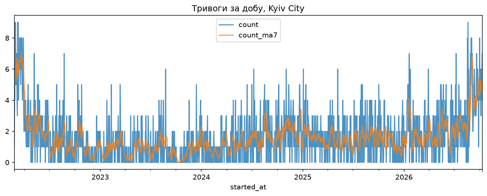
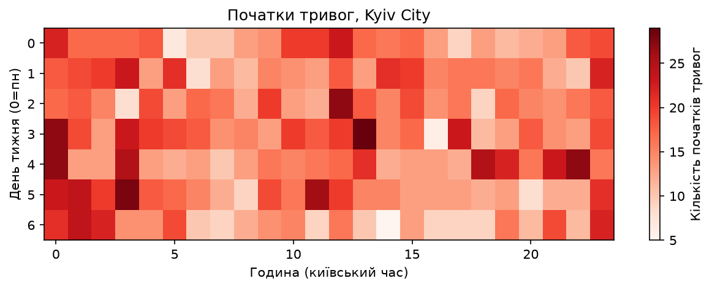
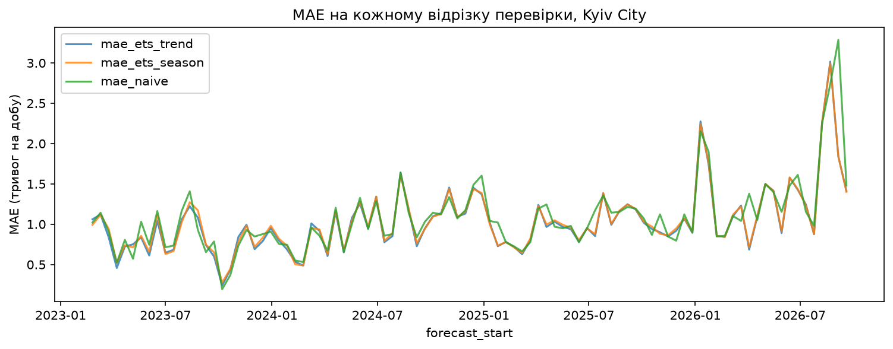
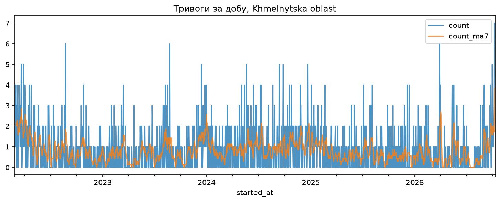
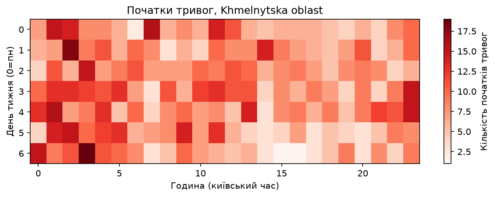
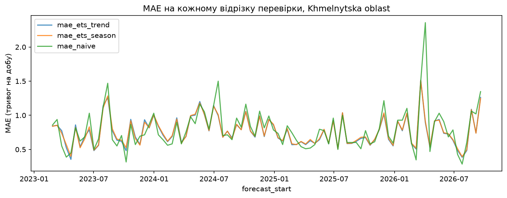

# Аналіз часових рядів сигналів повітряної тривоги в Україні

Навчальний проєкт: історичний аналіз добової кількості тривог у Києві та
Хмельницькій області (лютий 2022 - жовтень 2026). Це **аналіз для ситуаційної
обізнаності**, а не інструмент прогнозу конкретних ударів.

## Дані

Волонтерський датасет
[ukrainian-air-raid-sirens-dataset](https://github.com/Vadimkin/ukrainian-air-raid-sirens-dataset).
Копія, яку використовує скрипт, лежить у `data/volunteer_data_en.csv`
(англомовні назви регіонів; дані станом на 11 жовтня 2026). Файл
`data/volunteer_data_uk.csv` це версія з українськими назвами, скрипт її не
використовує.

Колонки: `region`, `started_at`, `finished_at`, `naive`. Час у даних у UTC,
скрипт переводить його в `Europe/Kyiv`. Дані поширюються за ліцензією
джерела, детальніше в репозиторії датасету.

## Що робить скрипт

1. Рахує тривоги по добах (часовий ряд) і ковзне середнє за 7 днів.
2. Будує теплокарту «день тижня × година початку».
3. Розкладає ряд методом STL на тренд, сезонність і залишок.
4. Знаходить аномальні дні (залишок більше 3 стандартних відхилень).
5. Перевіряє прогноз ковзною перевіркою: 94 відрізки по 14 днів, порівняння
   експоненційного згладжування (з трендом і без) із наївним прогнозом
   (середнє за останні 7 днів) і тест Вілкоксона на парних різницях помилок.

Остання (неповна) доба в даних у аналіз не входить.

## Запуск

Дані вже є в `data/`, окремо завантажувати нічого не треба.

```bash
python -m venv .venv
.venv\Scripts\activate          # Windows; на Mac/Linux: source .venv/bin/activate
pip install -r requirements.txt
python src/analysis.py "Kyiv City"
python src/analysis.py "Khmelnytska oblast"
```

Назви регіонів беруться з колонки `region`. Якщо назву вказано невірно,
скрипт виводить список доступних. Результати зберігаються в `outputs/` із
префіксом регіону. Інший файл даних можна вказати параметром `--file`.

## Результати

### Київ




### Хмельницька область




## Висновки

- В обох регіонах добова кількість тривог змінюється хвилями, без стійкого
  тренду чи сталого тижневого циклу.
- У Києві найвиразніший сплеск припадає на серпень-вересень 2026.
- У Хмельницькій області тривоги частіше починаються вночі й зранку; це
  візуальне спостереження, формально не перевірене. У Києві чіткого
  часового патерну немає.
- Експоненційне згладжування покращує середню помилку лише на 4-5% відносно
  наївного прогнозу (Київ: 1,03 проти 1,08; Хмельницька: 0,76 проти 0,79).
- Для Києва перевага моделі з трендом ледь помітна статистично (тест
  Вілкоксона, p = 0,042), для моделі без тренду недостовірна (p = 0,190).
  Для Хмельницької області різниця недостовірна (p = 0,204 і 0,248).
- Помилка прогнозу найбільша в періоди різкої зміни рівня.

## Обмеження

- Дані волонтерські, частина тривалостей оцінена (колонка `naive`, 30 хв).
- Тривоги залежать від рішень людей, а не від природних закономірностей;
  минулі закономірності можуть не діяти в майбутньому.
- Аналіз стосується лише добових підрахунків двох регіонів.
- Причини змін рівня з даних встановити не можна.
- Поріг аномалій розрахований на симетричний розподіл, а ряд несиметричний.
- p-значення орієнтовні: тест не враховує зв'язок між сусідніми відрізками.